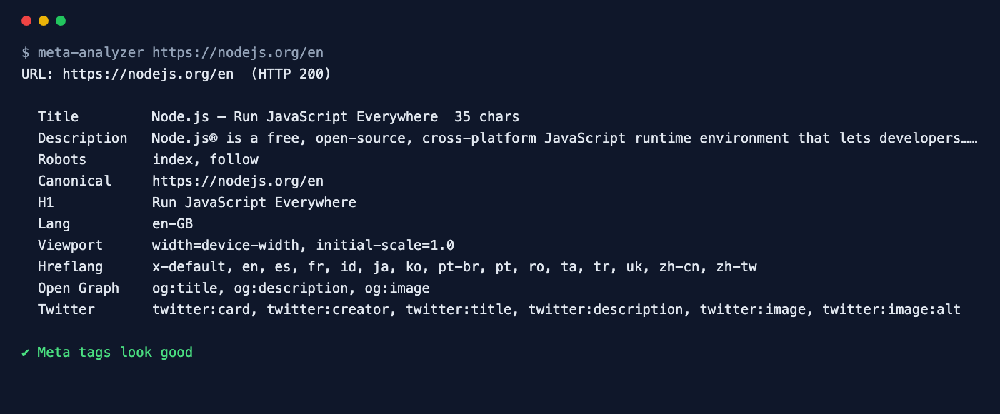

<div align="center">

# Meta Tag Analyzer

**Audit a page's title, description, robots and canonical tags in one command.**

[](https://github.com/ksanyok/meta-analyzer/actions/workflows/ci.yml) [](LICENSE)   [](https://promopilot.link/en/tools/meta-analyzer.php?utm_source=github&utm_medium=repo&utm_campaign=tools&utm_content=meta-analyzer)

**[▶ Use the free online version — no install, no sign-up](https://promopilot.link/en/tools/meta-analyzer.php?utm_source=github&utm_medium=repo&utm_campaign=tools&utm_content=meta-analyzer)**

</div>

`meta-analyzer` fetches a page (or reads a local HTML file) and reports everything search engines and social networks read from its `<head>`: the title and meta description with their lengths, meta robots and the `X-Robots-Tag` header, canonical links, viewport, language and charset, H1 headings, hreflang alternates, Open Graph and Twitter Card tags and JSON-LD blocks. It flags what costs rankings and clicks — an accidental `noindex`, two canonicals, a missing title or a description that will be cut off.



## What it checks

- `<title>` — present, one only, 30–60 characters
- Meta description — present, one only, not longer than ~160 characters
- `noindex` / `nofollow` in meta robots, `googlebot` and the `X-Robots-Tag` HTTP header
- Canonical link — one only, resolved to an absolute URL, and whether it points elsewhere
- Viewport, `<html lang>`, `<meta charset>`
- H1 headings (none or several)
- Hreflang alternates, Open Graph and Twitter Card tags, JSON-LD blocks and favicon
- HTTP status of the page after redirects

## Why it matters

Meta tags are small, invisible and decisive. A `noindex` copied from staging removes a page from Google; two canonical tags from a theme and a plugin make Google ignore both; a 90-character title gets cut mid-word in every search result. None of this shows up when you look at the page in a browser. Checking the head of your key templates after each release takes seconds and catches these before they cost traffic.

## Quick start

```bash
# run straight from GitHub, nothing to install
npx github:ksanyok/meta-analyzer example.com

# or install the CLI globally
npm install -g github:ksanyok/meta-analyzer
meta-analyzer example.com
```

Check a local build before deploying:

```bash
meta-analyzer --file dist/index.html
```

See what a crawler gets:

```bash
meta-analyzer https://example.com/product --ua "Googlebot"
```

Export metadata as JSON:

```bash
meta-analyzer example.com --json | jq '.meta | {title, description, canonical}'
```

## Example output

```text
$ meta-analyzer https://nodejs.org/en
URL: https://nodejs.org/en  (HTTP 200)

  Title         Node.js — Run JavaScript Everywhere  35 chars
  Description   Node.js® is a free, open-source, cross-platform JavaScript runtime environment that lets developers…  157 chars
  Robots        index, follow
  Canonical     https://nodejs.org/en
  H1            Run JavaScript Everywhere
  Lang          en-GB
  Viewport      width=device-width, initial-scale=1.0
  Hreflang      x-default, en, es, fr, id, ja, ko, pt-br, pt, ro, ta, tr, uk, zh-cn, zh-tw
  Open Graph    og:title, og:description, og:image
  Twitter       twitter:card, twitter:creator, twitter:title, twitter:description, twitter:image, twitter:image:alt

✔ Meta tags look good
```

## CLI

```text
Usage: meta-analyzer <url> [options]
       meta-analyzer --file page.html

Fetches a page and audits its SEO meta tags: title, meta description, robots
and X-Robots-Tag, canonical, viewport, lang, charset, H1, hreflang, Open Graph
and Twitter cards.

Options:
  --file <path>     Analyse a local HTML file
  --ua <agent>      User agent to send
  --json            Print JSON
  --strict          Exit with code 1 on warnings too
  -h, --help        Show this help

Online version (no install): https://promopilot.link/en/tools/meta-analyzer.php
```

## Use as a library

```js
import { analyzeMeta, extractMeta, lintMeta } from '@promopilot/meta-analyzer';

const report = await analyzeMeta('https://example.com/');
console.log(report.meta.title, report.meta.canonical, report.issues);

// Offline, e.g. in tests of your SSR output
const meta = extractMeta(html, 'https://example.com/page');
lintMeta(meta, { url: 'https://example.com/page' });
```

`analyzeMeta(url, { fetch, userAgent })` returns `{ url, finalUrl, status, xRobotsTag, meta, issues[], ok }`. `meta` contains `title`, `description`, `robots`, `canonical[]`, `viewport`, `charset`, `lang`, `hreflang[]`, `h1[]`, `og`, `twitter`, `jsonLd` and `favicon`. Issue codes are stable (`title-missing`, `title-long`, `description-long`, `noindex`, `canonical-multiple`, `viewport-missing`, `h1-missing`, …).

## Use in CI (GitHub Actions)

Catch an accidental noindex or a broken template in the build output:

```yaml
on: [push]
jobs:
  meta:
    runs-on: ubuntu-latest
    steps:
      - uses: actions/checkout@v4
      - run: npm ci && npm run build
      - uses: ksanyok/meta-analyzer@v1
        with:
          args: --file dist/index.html
```

## How it works

The page is fetched with Node's built-in `fetch`. Comments, `<script>`, `<style>`, `<noscript>` and `<template>` blocks are removed first, so commented-out tags and strings inside scripts are not mistaken for real ones. Tags are then read from `<head>` with a small attribute parser that handles single, double and unquoted values and decodes HTML entities. Relative canonical and hreflang URLs are resolved against the final URL after redirects.

## CLI vs. online version

| | This package | [Online tool](https://promopilot.link/en/tools/meta-analyzer.php?utm_source=github&utm_medium=repo&utm_campaign=tools&utm_content=meta-analyzer) |
|---|---|---|
| Runs on | Your machine, CI, build output | Any browser |
| Local HTML | Yes, `--file` | Published pages |
| Output | Text, JSON, exit codes | Visual report with SERP and social previews |
| Extras | Library for SSR tests | Related checks for schema, hreflang and Open Graph |
| Price | Free, MIT | Free, no sign-up |


## FAQ

<details>
<summary><b>How long should a title be?</b></summary>

Google cuts titles by pixel width (about 580 px), which is roughly 50–60 characters. Put the important words first so a cut does not hide them.
</details>

<details>
<summary><b>Does the meta description affect rankings?</b></summary>

Not directly, but it is often used as the snippet and influences clicks. Google rewrites it when it does not match the query, so write it for the page's main intent.
</details>

<details>
<summary><b>Is a canonical pointing to another URL an error?</b></summary>

Not necessarily — it is correct for duplicates and filtered views. The tool reports it as info so you can confirm it is intentional.
</details>

<details>
<summary><b>Does it run JavaScript?</b></summary>

No. It reads the HTML the server returns, which is what most crawlers see first. Tags injected only by client-side JavaScript will not be found.
</details>

<details>
<summary><b>Why is noindex an error?</b></summary>

Because it removes the page from search. If the page is meant to be hidden, ignore it for that URL.
</details>

<details>
<summary><b>Is there a version without installing anything?</b></summary>

Yes — the [online Meta Tag Analyzer](https://promopilot.link/en/tools/meta-analyzer.php?utm_source=github&utm_medium=repo&utm_campaign=tools&utm_content=meta-analyzer) runs the same checks in the browser and explains each result.
</details>

## Related free tools

- [Open Graph Debugger](https://promopilot.link/en/tools/og-debugger.php?utm_source=github&utm_medium=repo&utm_campaign=tools&utm_content=og-debugger) — preview and validate social sharing tags
- [SERP Preview](https://promopilot.link/en/tools/serp-preview.php?utm_source=github&utm_medium=repo&utm_campaign=tools&utm_content=serp-preview) — see how a title and description look in Google
- [Schema Validator](https://promopilot.link/en/tools/schema-validator.php?utm_source=github&utm_medium=repo&utm_campaign=tools&utm_content=schema-validator) — check JSON-LD structured data
- [Robots.txt Checker](https://promopilot.link/en/tools/robots-checker.php?utm_source=github&utm_medium=repo&utm_campaign=tools&utm_content=robots-checker) — test robots.txt rules against any URL
- [Keyword Density Checker](https://promopilot.link/en/tools/keyword-density.php?utm_source=github&utm_medium=repo&utm_campaign=tools&utm_content=keyword-density) — word and phrase frequency of a page
- [All 120+ free SEO, email and web tools](https://promopilot.link/en/tools/?utm_source=github&utm_medium=repo&utm_campaign=tools&utm_content=meta-analyzer)

## Contributing

Bug reports and pull requests are welcome — see [CONTRIBUTING.md](CONTRIBUTING.md). Security issues: [SECURITY.md](SECURITY.md).
More docs live in the [wiki](https://github.com/ksanyok/meta-analyzer/wiki) (sources in [docs/wiki](docs/wiki)).

## License

[MIT](LICENSE) © 2026 Alexandr Krikun

---

<sub>Built and maintained by the team behind [PromoPilot](https://promopilot.link/?utm_source=github&utm_medium=repo&utm_campaign=tools&utm_content=meta-analyzer) — link building, SEO monitoring and 120+ free tools for site owners. Also on [YouTube](https://www.youtube.com/channel/UCPB8m7BgaexcZh0Vr49ViYA).</sub>
